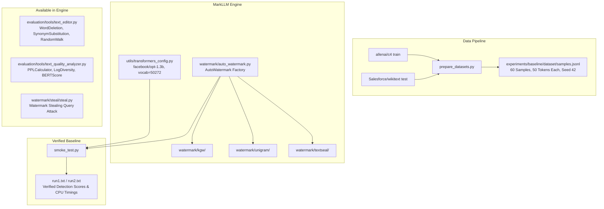

# LLM-SEC: Rigorous Security, Detectability, and Linguistic Quality Evaluation of LLM Watermarking Frameworks

<div align="center">

[](LICENSE)
[](https://www.python.org/)
[](https://pytorch.org/)
[](https://huggingface.co/docs/transformers)
[]()

**Academic Research Project — Batch AIM-B10**  
*Department of Artificial Intelligence & Machine Learning*

</div>

---

## 📌 Project Overview

**LLM-SEC** (LLM-WatermarkSec) is an academic research platform and benchmarking framework designed to evaluate the **security, detectability, adversarial robustness, and linguistic quality trade-offs** of Large Language Model (LLM) text watermarking technologies.

Built upon the modular foundation of **MarkLLM** (EMNLP 2024), the project investigates how different watermarking paradigms—ranging from heuristic red-green logit biasing to modern cryptographic dual-key signatures—withstand real-world perturbation attacks (word deletion, synonym substitution, paraphrasing) and black-box query stealing attacks without compromising generated text perplexity.

---

## 👥 Academic Team & Supervision

- **Project Guide**: **Dr. M. Manoj Kumar**
- **Batch**: **AIM-B10**
- **Institution**: Department of AIML

### Team Members & Division of Responsibilities

| Member Name | Student ID | GitHub Handle | Primary Research Responsibility | Assigned Branch |
| :--- | :---: | :---: | :--- | :--- |
| **N. Abhinay Sucharith** (Lead) | `23BQ1A6194` | [@Abhinay6699](https://github.com/Abhinay6699) | **Architecture & Integration**: Framework architecture, code reviews, PR merging, and `main` branch maintenance. | `main` |
| **K. V. N. Sai Tarun** | `23BQ1A6168` | [@tarunkondapi](https://github.com/tarunkondapi) | **Dataset & Experiment Pipeline**: Dataset curation, validation scripts, batch experiment automation. | `feature/dataset-pipeline`, `feature/batch-experiments` |
| **K. Naga Phani Teja** | `24BQ5A6128` | [@Kethineninagaphaniteja](https://github.com/Kethineninagaphaniteja) | **Watermark Algorithms & Detection**: Implementation and audit of KGW, Unigram, TextSeal, and detection metrics ($z$-scores, ROC). | `feature/watermark-detection` |
| **M. Mahesh** | `23BQ1A6180` | [@Mahesh08082004](https://github.com/Mahesh08082004) | **Robustness & Quality Evaluation**: Adversarial perturbation attacks (word deletion, paraphrasing), quality metrics (PPL, BERTScore), visualizations. | `feature/robustness-evaluation` |

---

## 🔬 The Research Problem: The Watermark Trilemma

Every text watermarking scheme operates under a fundamental three-way trade-off:

```
                          Detectability
                         (High Separation,
                          Zero False Positives)
                                 /\
                                /  \
                               /    \
                              /      \
                             /        \
                            /          \
                           /____________\
                Robustness                Linguistic Quality
             (Survives Deletion,          (Low Perplexity Distortion,
              Paraphrasing & Stealing)     High Fluency & Diversity)
```

1. **Symmetric Key Vulnerability**: In classical rule-based watermarks like **KGW**, generation and detection share the same key. Exposing the detector allows adversaries to reverse-engineer green-token partitions and forge watermarks on malicious text.
2. **Fragility Under Perturbation**: Simple post-processing edits (word deletion, synonym replacement) disrupt n-gram hashing histories, collapsing detection confidence.
3. **Linguistic Distortion**: Increasing watermark strength ($\delta$) biases model distributions away from natural language, elevating perplexity.

---

## 🏗️ System Architecture



---

## 📂 Repository Structure

```text
llm-watermarksec/
├── docs/                                  # Academic & architectural documentation
│   ├── PROJECT_ARCHITECTURE.md            # Detailed subsystem specifications & class diagrams
│   ├── PROJECT_ONBOARDING.md              # Beginner-to-advanced onboarding & Guide FAQ
│   ├── IMPLEMENTATION_STATUS.md           # Grounded audit of implemented vs planned components
│   └── RESEARCH_WORKFLOW.md               # 5-phase experimental research lifecycle
├── presentations/                         # Presentation assets & guide defense briefs
│   ├── LLM_SEC_PRESENTATION_BRIEF.md      # 19-section guide meeting brief & talking points
│   └── SLIDE_DECK_SLIDES.md               # 12-slide ready-to-present PPT deck & speaker script
├── MarkLLM/                               # Core watermarking & evaluation library
│   ├── config/                            # Hyperparameter configurations for all 24 algorithms
│   ├── dataset/                           # Dataset loader definitions (C4, WMT16, HumanEval)
│   ├── evaluation/                        # Evaluation pipelines, attacks, and quality analyzers
│   │   ├── pipelines/                     # Detection & quality analysis pipeline classes
│   │   └── tools/                         # Text editors (attacks), success rate & quality tools
│   ├── experiments/                       # Project-specific curated experiments
│   │   └── baseline/dataset/              # 60-sample curated baseline (samples.jsonl)
│   ├── watermark/                         # 24 watermark algorithm implementations
│   │   ├── kgw/                           # Kirchenbauer et al. (ICML 2023)
│   │   ├── unigram/                       # Zhao et al. (ICLR 2024)
│   │   ├── textseal/                      # Dual-key cryptographic watermark (2026)
│   │   ├── synthid/                       # DeepMind Nature 2024
│   │   ├── steal/                         # Watermark stealing attack implementation
│   │   └── ...                            # SIR, SemStamp, EXP, UPV, etc.
│   ├── utils/                             # TransformersConfig and helper functions
│   ├── visualize/                         # Visualizers for token-level green/red highlighting
│   ├── prepare_datasets.py                # Dataset curation script (streaming, filtering)
│   ├── smoke_test.py                      # End-to-end execution & validation harness
│   ├── scratch_datasets.py                # Streaming loader sanity checker
│   ├── scratch_print.py                   # Token length & source verification script
│   ├── run1.txt                           # Empirical run 1 execution log (CPU timings & scores)
│   ├── run2.txt                           # Empirical run 2 execution log (CPU timings & scores)
│   └── requirements.txt                   # MarkLLM internal dependencies
├── .gitignore                             # Git ignore rules for caches, models & large binaries
├── LICENSE                                # Apache 2.0 Open Source License
├── README.md                              # Main project documentation & team guide
└── requirements.txt                       # Project-wide Python dependencies
```

---

## 📊 Current Implementation Status

| Component | Status | Empirical Evidence |
| :--- | :---: | :--- |
| **Model Environment** | **Completed** | `facebook/opt-1.3b` verified with automatic fallback to `facebook/opt-125m`. |
| **Baseline Dataset** | **Completed** | Exactly 60 prompts (30 C4 + 30 WikiText-103), exactly 50 tokens each (`samples.jsonl`, seed `42`). |
| **Smoke Test Harness** | **Completed** | `smoke_test.py` tested and confirmed in `run1.txt` and `run2.txt`. |
| **Watermark Algorithms** | **Completed** | 24 algorithms available in `watermark/`; KGW, Unigram, and TextSeal actively validated. |
| **Adversarial Attack Library** | **Available in Engine** | `WordDeletion`, `SynonymSubstitution`, `GPTParaphraser`, `RandomWalkAttack` ready in `text_editor.py`. |
| **Watermark Stealing Module** | **Available in Engine** | Frequency-based key extraction attack implemented in `watermark/steal/steal.py`. |
| **Quality Evaluation Tools** | **Available in Engine** | `PPLCalculator`, `LogDiversityAnalyzer`, `BERTScore` present in `text_quality_analyzer.py`. |
| **Batch Experiment Runner** | **Ongoing** | Automated driver script iterating over all 60 samples across attack sweeps. |
| **Robustness Sensitivity Curves** | **Planned** | Measuring TPR @ 1% FPR under increasing deletion/substitution ratios. |
| **GPU Acceleration** | **Pending** | Current execution is CPU-only; GPU cluster will be used for large sweeps. |

---

## 📈 Empirical Smoke-Test Results

Executed on local Windows 11 workstation (`PyTorch 2.6.0+cpu`, `facebook/opt-1.3b`, 15.71 GB RAM):

| Algorithm | Text Condition | Generated Chars | Detection Score | Run 1 Latency | Run 2 Latency | Outcome |
| :--- | :--- | :---: | :---: | :---: | :---: | :--- |
| **KGW** | Watermarked | 1,056 | **$z = 10.5568$** | 85.27s | 102.25s | Signal detected ($p < 10^{-25}$) |
| **KGW** | Unwatermarked | 877 | **$z = 0.7366$** | 86.28s | 82.59s | Negative control valid ($z < 4.0$) |
| **Unigram** | Watermarked | 616 | **$z = 6.5033$** | 46.61s | 44.81s | Signal detected ($p < 10^{-10}$) |
| **Unigram** | Unwatermarked | 256 | **$z = -0.2626$** | 14.41s | 15.95s | Negative control valid ($z \approx 0$) |
| **TextSeal** | Watermarked | 239 | **Score $= 13.3722$** | 13.64s | 15.29s | Dual-key cryptographic signal detected |
| **TextSeal** | Unwatermarked | 257 | **Score $= 0.3612$** | 23.14s | 16.25s | Negative control valid |

> **Key Finding**: In all tested algorithms, watermarked texts exhibited massive statistical separation from unwatermarked controls, with **zero false positives** on natural text.

---

## 🚀 Quickstart & Setup Guide

### 1. Environment Setup

```bash
# Clone the repository
git clone https://github.com/Abhinay6699/llm-watermarksec.git
cd llm-watermarksec

# Create and activate a virtual environment
python -m venv venv
# On Windows:
venv\Scripts\activate
# On Linux/macOS:
source venv/bin/activate

# Install dependencies
pip install -r requirements.txt
```

### 2. Reproduce the Baseline Dataset

```bash
cd MarkLLM
python prepare_datasets.py
```
*Outputs: `MarkLLM/experiments/baseline/dataset/samples.jsonl` (60 curated samples).*

### 3. Run the End-to-End Smoke Test

```bash
cd MarkLLM
python smoke_test.py
```
*Runs `facebook/opt-1.3b` across KGW, Unigram, and TextSeal, printing detection scores and runtimes.*

---

## 🤝 Collaborative Branching & Contribution Workflow

To maintain a clean and reliable codebase, team members follow this strict Git workflow:

```
main (Protected, stable production code — maintained by Abhinay)
  ▲
  │ (Pull Request Review & Squash-Merge)
  │
feature/* or docs/* (Teammate Feature Branches)
```

### Step-by-Step Teammate Workflow:

1. **Clone and Configure**:
   ```bash
   git clone https://github.com/Abhinay6699/llm-watermarksec.git
   cd llm-watermarksec
   git config user.name "Your GitHub Name"
   git config user.email "your_email@example.com"
   ```

2. **Create Your Assigned Feature Branch**:
   ```bash
   git checkout -b feature/<your-assigned-feature>
   ```

3. **Make Commits & Push**:
   ```bash
   git add <modified-files>
   git commit -m "feat(<component>): descriptive commit message"
   git push origin feature/<your-assigned-feature>
   ```

4. **Open a Pull Request**:
   - Open a PR targeting `main`.
   - Provide a clear description of changes and attach test logs.
   - Tag **@Abhinay6699** for review.

5. **Review & Merge**:
   - Abhinay conducts code review.
   - Once approved, the PR is integrated into `main` using **Squash and merge**.

---

## 📚 Genuine Academic References

1. **Kirchenbauer, J., et al.** (2023). *A Watermark for Large Language Models*. ICML 2023. [arXiv:2301.10226](https://arxiv.org/abs/2301.10226).
2. **Zhao, X., et al.** (2024). *Provable Robust Watermarking for AI-Generated Text*. ICLR 2024. [arXiv:2306.17439](https://arxiv.org/abs/2306.17439).
3. **Liu, A., et al.** (2024). *An Unforgeable Publicly Verifiable Watermark for Large Language Models*. ICLR 2024. [arXiv:2307.16230](https://arxiv.org/abs/2307.16230).
4. **Liu, A., et al.** (2024). *A Semantic Invariant Robust Watermark for Large Language Models*. ICLR 2024. [arXiv:2310.06356](https://arxiv.org/abs/2310.06356).
5. **Pan, L., et al.** (2024). *MarkLLM: An Open-Source Toolkit for LLM Watermarking*. EMNLP 2024 Demo. [arXiv:2405.10051](https://arxiv.org/abs/2405.10051).
6. **Kuditipudi, R., et al.** (2024). *Robust Distortion-free Watermarks for Language Models*. TMLR 2024. [arXiv:2307.15593](https://arxiv.org/abs/2307.15593).
7. **Kumar, A., et al. (Google DeepMind)** (2024). *Scalable watermarking for identifying large language model outputs*. Nature, 634, 818–823.
8. **TextSeal Authors** (2026). *TextSeal: A Dual-Key Watermark for Large Language Models*. [arXiv:2605.12456](https://arxiv.org/abs/2605.12456).

---

## 📄 License

This project is licensed under the **Apache License 2.0** — see the [LICENSE](LICENSE) file for details.
