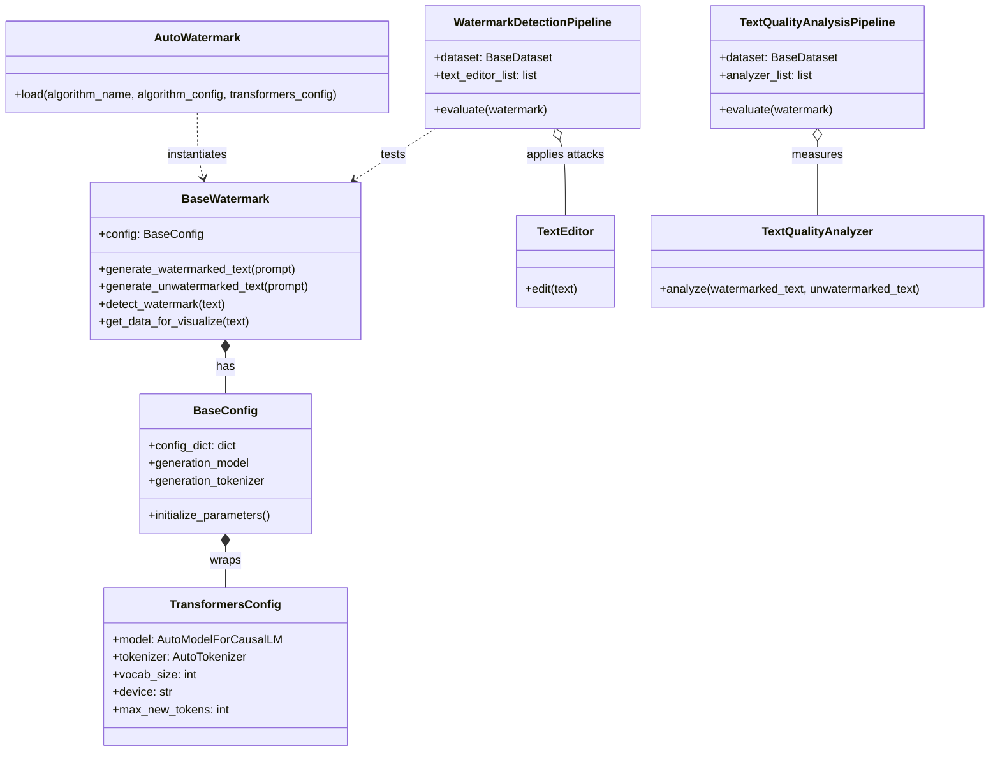

# LLM-SEC / LLM-WatermarkSec: Project Architecture

## 1. System Overview & Executive Summary

The **LLM-WatermarkSec** project is an academic research and engineering framework built on top of the state-of-the-art **MarkLLM** foundation (originating from Tsinghua University's BPM group and published at EMNLP 2024). The project's core mission is to investigate, benchmark, and evaluate the **security, detectability, robustness, and linguistic quality trade-offs** of Large Language Model (LLM) text watermarking technologies.

```
+---------------------------------------------------------------------------------------------------+
|                                     LLM-SEC WORKSPACE LAYER                                        |
|  [prepare_datasets.py]           [smoke_test.py]            [run1.txt / run2.txt]                 |
|  Dataset Curation & Filter       End-to-End Pipeline Check  CPU Validation Runs (OPT-1.3B)        |
+---------------------------------------------------------------------------------------------------+
                                                  |
                                                  v
+---------------------------------------------------------------------------------------------------+
|                                      MarkLLM CORE ENGINE                                          |
|                                                                                                   |
|  +----------------------------+  +----------------------------+  +----------------------------+  |
|  |     Watermark Subsystem    |  |     Evaluation Engine      |  |    Visualization Suite     |  |
|  | 24 Algorithms (KGW,        |  | Detection Pipelines        |  | Discrete & Continuous      |  |
|  | Unigram, SynthID, etc.)    |  | Quality Pipelines          |  | Highlighting               |  |
|  | Logits Processors          |  | Adversarial Attack Editors |  | PDF / Image Renderers      |  |
|  +----------------------------+  +----------------------------+  +----------------------------+  |
|                                                                                                   |
|  +--------------------------------------------------------------------------------------------+  |
|  |                             Utils & Configuration Infrastructure                           |  |
|  | [AutoWatermark]  [AutoConfig]  [TransformersConfig]  [BaseConfig]  [BaseWatermark]         |  |
|  +--------------------------------------------------------------------------------------------+  |
+---------------------------------------------------------------------------------------------------+
                                                  |
                                                  v
+---------------------------------------------------------------------------------------------------+
|                                    BASE HARDWARE & RUNTIME                                        |
|  PyTorch 2.6.0+cpu  |  HuggingFace Transformers 4.53.3  |  OPT-1.3B / OPT-125M  |  Windows 11 CPU  |
+---------------------------------------------------------------------------------------------------+
```

---

## 2. Knowledge Graph: Modules, Classes & Relationships



---

## 3. Detailed Component Architecture

### A. Watermark Algorithms Catalog (24 Algorithms)

The repository provides a modular, extensible collection of 24 watermark algorithms categorised into families:

| Family | Algorithms | Core Mechanism | Key Papers |
| :--- | :--- | :--- | :--- |
| **KGW / Red-Green Rule-based** | `KGW`, `Unigram`, `SWEET`, `Adaptive`, `MorphMark` | Splits vocabulary at each step into green/red lists using hash of preceding token(s); adds $\delta$ bias to green logits. | Kirchenbauer et al. (ICML 2023), Zhao et al. (ICLR 2024), Lee et al. (ACL 2024) |
| **Cryptographic / Dual-Key** | `TextSeal`, `UPV` | Uses asymmetric cryptographic keys or dual-key schemes for public verification without leaking generation key. | Liu et al. (ICLR 2024), TextSeal (2026) |
| **Semantic / Embedding-based** | `SIR`, `X-SIR`, `SemStamp`, `k-SemStamp`, `DEW` | Uses sentence/token semantic representations (e.g. cross-lingual embeddings, clustering) invariant to paraphrasing. | Liu et al. (ICLR 2024), He et al. (ACL 2024), Hou et al. (2024) |
| **Distortion-Free / Pseudo-Random** | `EXP`, `EXPGumbel`, `EXPEdit`, `ITSEdit`, `DIP`, `Unbiased`, `PF` | Replaces standard sampling with pseudo-random number generators (PRNG) or inverse transform sampling without distorting model distribution. | Aaronson (2023), Kuditipudi et al. (TMLR 2024), Hu et al. (ICLR 2024) |
| **Neural / End-to-End** | `E2E`, `TS` (Token-Specific), `SynthID` | Directly trains or uses neural discriminators / bayesian scoring to bias logits or score text. | DeepMind Nature (2024), ICML 2025 |
| **Entropy-Conditioned** | `EWD`, `IE` | Dynamically conditions watermark strength based on token entropy to preserve high-information tokens. | Lu et al. (ACL 2024), IE (2025) |

### B. Dynamic Instantiation: Factory Pattern (`AutoWatermark` & `AutoConfig`)

- `AutoWatermark.load(algorithm_name, algorithm_config, transformers_config)`:
  1. Resolves algorithm identifier to class path via `WATERMARK_MAPPING_NAMES`.
  2. Dynamically loads the corresponding class via `importlib`.
  3. Uses `AutoConfig.load()` to parse JSON parameter files from `config/<algorithm>.json`.
  4. Injects `TransformersConfig` containing model weights, tokenizer, and sampling hyper-parameters (`max_new_tokens`, `min_length`, `do_sample`, `no_repeat_ngram_size`).

### C. Security Attack & Perturbation Subsystem (`evaluation/tools/text_editor.py`)

This module houses the adversarial attacks used to test watermark persistence:
1. **Token Deletion (`WordDeletion`)**: Randomly drops words with probability $p$.
2. **Lexical Substitution (`SynonymSubstitution`, `ContextAwareSynonymSubstitution`)**: Replaces words with WordNet or BERT-suggested synonyms.
3. **Paraphrase Attacks (`DipperParaphraser`, `GPTParaphraser`)**: Uses DIPPER or GPT models to rewrite sentences while keeping semantics.
4. **Adversarial Trajectory Search (`RandomWalkAttack`)**: Implements the ICML 2024 impossibility result attack that perturbs sentences guided by an oracle to erase watermarks.
5. **Back-Translation (`BackTranslationTextEditor`)**: Translates EN -> foreign language -> EN.
6. **Watermark Stealing Attack (`watermark/steal/steal.py`)**: Attacks the watermark private key / green list by observing output frequency distributions across repeated queries (`countstore.py`).

### D. Evaluation Metrics & Success Rate Pipeline

1. **`WatermarkDetectionPipeline`**:
   - Takes a dataset (e.g., C4, WikiText), generates text, subjects it to a chain of `text_editor` attacks, and computes detection statistics ($z$-score, p-value).
   - Produces TPR (True Positive Rate), FPR (False Positive Rate), AUC-ROC, and F1 metrics via `DynamicThresholdSuccessRateCalculator` and `FundamentalSuccessRateCalculator`.
2. **`TextQualityAnalysisPipeline`**:
   - Evaluates whether watermarking degrades output quality.
   - Direct: Perplexity (`PPLCalculator`), LogDiversity (`LogDiversityAnalyzer`).
   - Referenced: `BLEUCalculator`, `ROUGE1/2/L`, `BERTScoreCalculator`, `PassOrNotJudger` (for code).
   - External: `GPTTextDiscriminator` (LLM-as-a-judge comparison).

---

## 4. Hardware and Dependency Profile

The active environment operates under the following constraints:
- **Operating System**: Windows 11 AMD64
- **Python**: 3.12.4
- **PyTorch**: 2.6.0+cpu (CPU only, no CUDA available)
- **Transformers**: 4.53.3
- **Primary Model**: `facebook/opt-1.3b` (with fallback to `facebook/opt-125m` if RAM exhausted)
- **System Memory**: 15.71 GB RAM (execution time is ~15s to ~100s per sample on CPU).

