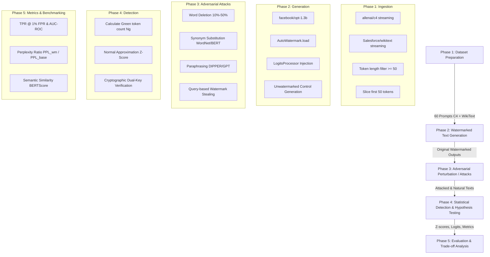

# LLM-SEC / LLM-WatermarkSec: Research Workflow & Experimental Protocols

## 1. End-to-End Research Lifecycle

The research pipeline in `LLM-SEC` is structured into five sequential, reproducible phases:

---

## 2. Threat Model Definition

For our academic evaluation and defense, we formalize the threat model under the standard cryptography/security taxonomy:

| Dimension | Specification in Our Research |
| :--- | :--- |
| **Defender (Watermark Authority)** | Embeds statistical or cryptographic signals into LLM generations to establish ownership and detect AI-synthesized content. |
| **Attacker Objective 1 (Watermark Removal)** | Strip or degrade the watermark signal below the detection threshold while preserving the grammatical and semantic fluency of the text. |
| **Attacker Objective 2 (Watermark Forgery / Spoofing)** | Generate malicious or human text containing a valid watermark to frame the LLM owner or bypass security filters. |
| **Attacker Objective 3 (Watermark Extraction / Stealing)** | Reverse-engineer the secret key / green list rules via black-box API queries. |
| **Attacker Capability Levels** | 1. **No-Model Perturbation**: Character/word deletion, random substitution. 2. **Surrogate Model**: Paraphrasing using an unwatermarked auxiliary model (e.g., DIPPER, GPT-3.5). 3. **API Query Access**: Sending multiple prompts to observe token distributions (`watermark/steal/`). |

---

## 3. Standard Experimental Protocols

### Protocol A: Baseline Detectability & Separation Evaluation
- **Goal**: Measure the baseline separability of watermarked vs. unwatermarked text under zero attack.
- **Input**: 60 prompts from `experiments/baseline/dataset/samples.jsonl`.
- **Target Algorithms**: `KGW`, `Unigram`, `TextSeal`, `SIR`, `SynthID`.
- **Primary Metric**:
  $$z = \frac{N_G - \gamma N}{\sqrt{N \gamma (1-\gamma)}}$$
  Compute separation distance: $\Delta = \mathbb{E}[z_{\text{watermarked}}] - \mathbb{E}[z_{\text{unwatermarked}}]$.
- **Target**: Separation $\Delta > 8.0$ with zero false positives at threshold $\tau = 4.0$.

### Protocol B: Robustness Against Text Editing Attacks
- **Goal**: Evaluate detection decay when text undergoes varying levels of word deletion and synonym substitution.
- **Perturbation Levels**:
  - `WordDeletion`: $p \in \{0.1, 0.2, 0.3, 0.4, 0.5\}$
  - `SynonymSubstitution`: $p \in \{0.1, 0.2, 0.3\}$
- **Primary Metrics**:
  - **TPR @ 1% FPR**: The True Positive Rate achieved when threshold is set so that FPR $\le 0.01$.
  - **Area Under the ROC Curve (AUC-ROC)** across varying thresholds.

### Protocol C: Linguistic Quality & Perplexity Trade-Off
- **Goal**: Verify that watermarking does not degrade the coherence and readability of the LLM.
- **Metrics**:
  - **Perplexity (PPL)**: Calculated using a separate evaluation model via `evaluation/tools/text_quality_analyzer.py` (`PPLCalculator`).
  - **Repetition & Diversity**: `LogDiversityAnalyzer` to ensure the watermark does not trigger repetitive loops.
  - **Semantic Drift**: `BERTScore` between watermarked output and greedy unwatermarked reference.

### Protocol D: Watermark Stealing Vulnerability
- **Goal**: Measure how many API queries an attacker requires to reconstruct the watermark green list using `watermark/steal/steal.py`.
- **Metric**: Green-list extraction accuracy as a function of query count $K \in \{500, 1000, 5000\}$.

---

## 4. Academic Guide Presentation Talking Points

1. **"Why start with 60 samples from C4 and WikiText?"**
   > *Explanation*: "60 samples is the optimal statistical sample size for preliminary validation on local CPU hardware. It provides 30 news/encyclopedic prompts (WikiText) and 30 open-web conversational prompts (C4), totaling 3,000 prompt tokens. This gives sufficient statistical power to verify $\Delta z$ while keeping total execution runtime within tractable limits on CPU (~1 hour per pass)."

2. **"Why compare KGW against TextSeal?"**
   > *Explanation*: "KGW represents the classical symmetric, rule-based approach where knowing how to detect reveals how to forge. TextSeal represents modern 2026 dual-key cryptographic watermarking, providing an asymmetric verification guarantee. Comparing them directly addresses the central security dilemma of modern AI watermarking."

3. **"How does our work extend MarkLLM?"**
   > *Explanation*: "MarkLLM provides the foundational library implementations. Our contribution in LLM-SEC is formulating the rigorous security evaluation framework: systematically testing the attack surface (perturbation and query stealing), calibrating detection thresholds, and auditing the quality-security Pareto frontier."

